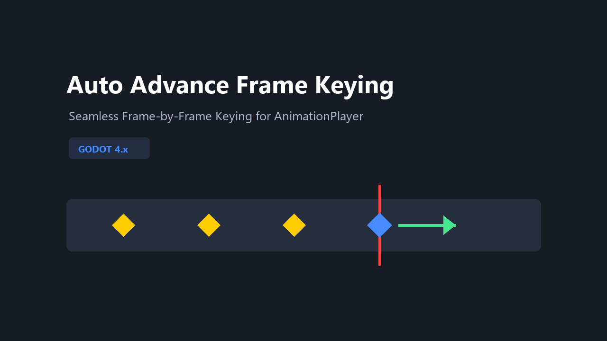

# Auto Advance Frame Keying (Godot 4)

A quality-of-life editor plugin for Godot 4.x that automatically increments the sprite frame and steps forward on the AnimationPlayer timeline whenever you key the `frame` or `frame_coords` property in the Inspector.

## Features
- Works seamlessly with **Sprite2D**, **Sprite3D**, and **AnimatedSprite2D**.
- Automatically moves the AnimationPlayer playhead forward by the animation's current step size.
- Automatically increments the node's `frame` or `frame_coords`.
- No need to manually seek the timeline or change frame values between keys!

## Installation
1. Search for **Auto Advance Frame Keying** in the Godot AssetLib tab inside the editor and install it, or download this repository.
2. Ensure the plugin folder is placed at `res://addons/auto_advance_keyframes/`.
3. Open Godot, go to **Project > Project Settings > Plugins**, and enable **Auto Advance Frame Keying**.

## License
MIT License - see [LICENSE](LICENSE) for details.
